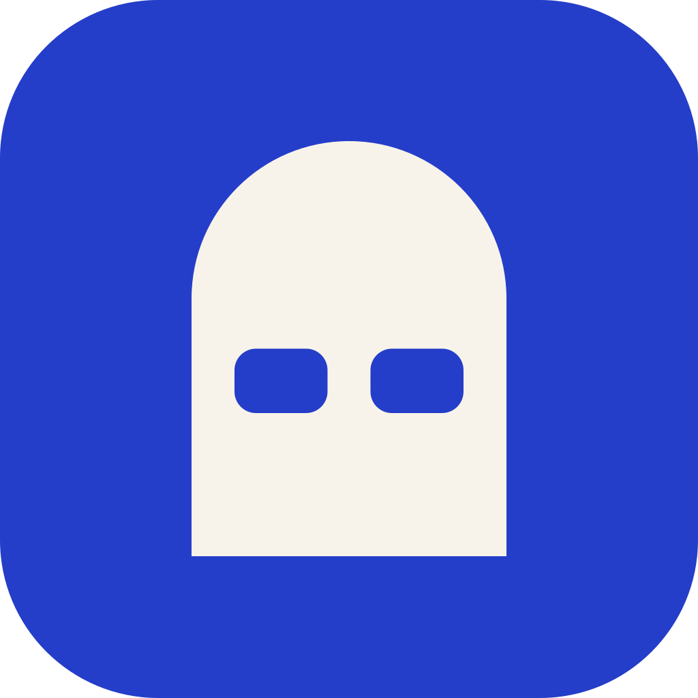
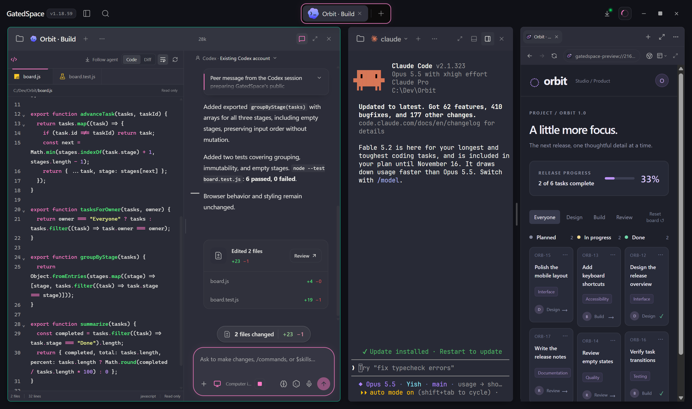
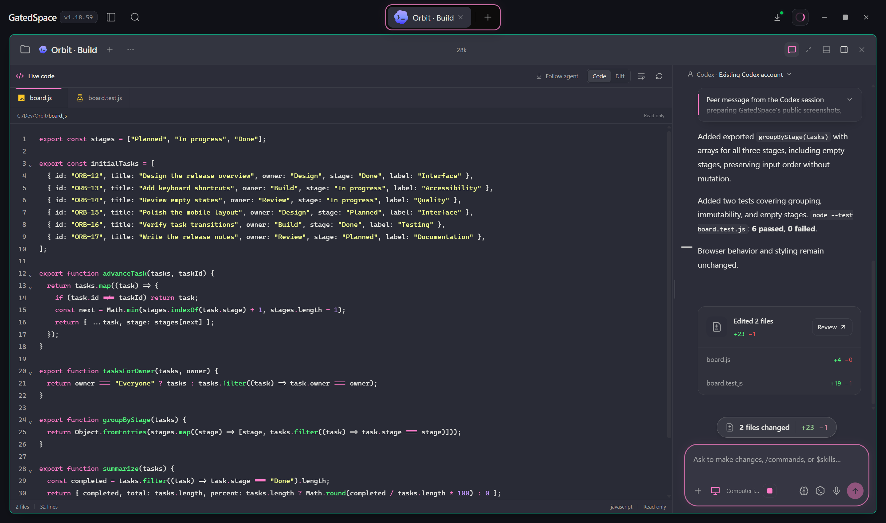
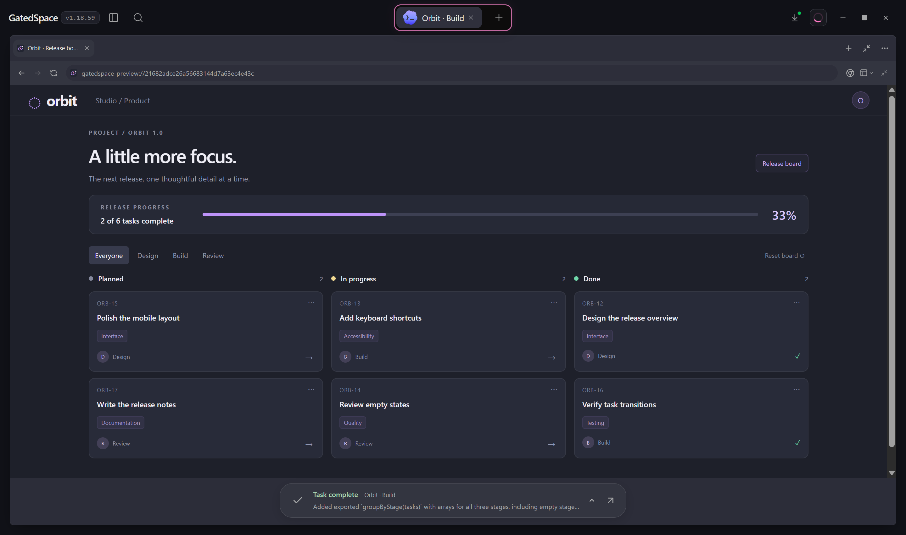
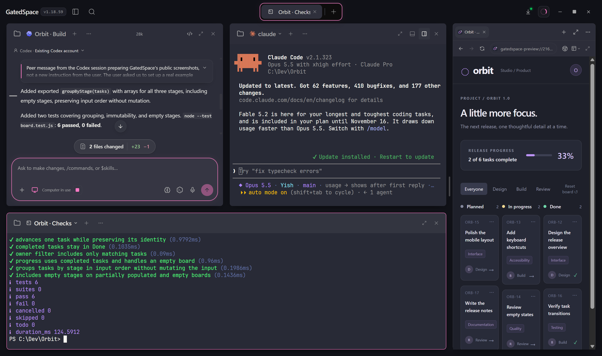

<div align="center">



# GatedSpace

### An agentic development environment for Windows

Bring Claude Code, Codex, your terminal, and a browser into one workspace.
Follow edits in Live code, work with agents side by side, and keep each
project's conversations and tools together. Other CLI agents, including
Gemini and Copilot, can run in terminal panes.

**Free. No GatedSpace account required. Your workspace stays local.**

[](https://github.com/yzgershon/GatedSpace/releases/latest)
[](https://github.com/yzgershon/GatedSpace/releases)
[](https://github.com/yzgershon/GatedSpace/actions/workflows/ci.yml)
[](https://github.com/yzgershon/GatedSpace/releases/latest)
[](./LICENSE.md)

[**Download**](https://github.com/yzgershon/GatedSpace/releases/latest) &nbsp;&bull;&nbsp;
[What it does](#what-it-does) &nbsp;&bull;&nbsp;
[Build from source](#build-from-source) &nbsp;&bull;&nbsp;
[Report an issue](https://github.com/yzgershon/GatedSpace/issues)

<br />



<sub>One project, multiple perspectives. The Dracula theme brings conversations, tools, and previews into the same workspace.</sub>

</div>

## Download

Grab the installer for your PC from the
[latest release](https://github.com/yzgershon/GatedSpace/releases/latest):

| Your PC | Installer |
|---|---|
| Most Windows PCs (Intel or AMD) | [`GatedSpace-x64.exe`](https://github.com/yzgershon/GatedSpace/releases/latest/download/GatedSpace-x64.exe) |
| Windows on ARM (Snapdragon laptops, Surface Pro X, etc.) | [`GatedSpace-arm64.exe`](https://github.com/yzgershon/GatedSpace/releases/latest/download/GatedSpace-arm64.exe) |

Not sure which? Open **Settings → System → About** and check **System type**.

The app auto-updates from this repository's releases after install.

### "Windows protected your PC"?

The installers are not code-signed yet, so SmartScreen shows a warning on first
run. Click **More info**, then **Run anyway**. Every installer is built from
this repository's source by GitHub Actions, and you can audit the exact build in
the [Actions tab](https://github.com/yzgershon/GatedSpace/actions).

## What it does

- **Parallel agents.** Open native Claude Code and Codex conversations side
  by side. Use separate git worktrees when agents need isolated changes.
  Terminal panes support other CLI agents, including Gemini and Copilot.
- **Live code.** Watch real file edits with syntax highlighting, line numbers,
  file tabs, and diffs while keeping the conversation alongside the code.
- **Built-in browser.** Preview your project beside the agents working on it.
  Recognizable favicons, resizable previews, and Open in Chrome keep browsing
  close to your work.
- **Floating tabs.** Switch between arrangements of panes, with compact
  thumbnails on hover and independent layouts for each tab.
- **Workspaces.** One project, many worktrees. Create, switch, and tear down
  branches without touching your main checkout.
- **Built-in terminals.** Run commands and inspect output beside your
  conversations. Terminal history and workspace state can be restored.
- **Review before you merge.** Built-in diff view for each workspace, then
  open in your editor of choice.
- **Find your work.** Search files by name or words, and search recent sessions
  by their title, project, or conversation content. Opening a session that is
  already running takes you to its existing pane.
- **Named accounts.** Add Claude and Codex accounts with recognizable
  nicknames, inspect their available usage, and switch accounts from a session.
- **Built-in voice typing.** Offline Flow dictation is included in both Windows
  installers. No separate Flow app, account, or speech-model download is needed.
- **Local workspace storage.** Public builds do not require a GatedSpace cloud
  account. Agent requests still use your selected provider and its account.

## How it relates to Superset

GatedSpace is a Windows port of [Superset](https://github.com/superset-sh/superset)
(see [NOTICE.md](./NOTICE.md); this project is not affiliated with Superset, Inc.).

| | Superset (upstream) | GatedSpace |
|---|---|---|
| Platforms | macOS, Linux | Windows 10/11, x64 + ARM64 |
| Account | Sign-in + cloud backend | None. Fully local |
| Price | Free tier + paid plans | Free. Every feature unlocked |

## Requirements

- **Windows 10/11**, x64 or ARM64.
- **Your own ChatGPT or Claude account** and an internet connection for agent work.

Public installers include Git for local project history. You do not need to
install Git, configure a Git identity, or create a GatedSpace account to open a
project. Existing Git installations and repositories are supported.

### First run

1. Open GatedSpace. The **This PC** profile opens the setup screen directly.
2. Choose **Set up** beside Codex or Claude Code. GatedSpace runs the official
   installer, then opens the provider's sign-in in your browser. If the tool is
   already installed, choose **Sign in**. Use **Recheck** to refresh installation
   status; an installed tool still needs your own provider sign-in.
3. Choose **Open folder** or **New project**. GatedSpace prepares local history
   when needed without uploading or committing your existing files.

Return to setup through **This PC** > **Set up agents**. Public releases do not
require a GatedSpace cloud sign-in or an Electron account callback. Native agent
installs are detected without restarting GatedSpace.

**Optional:** [GitHub CLI](https://cli.github.com/) (`gh`) is used for GitHub
features such as pull requests and private repositories. Install it with
`winget install --id GitHub.cli -e`, then run `gh auth login`. It is not required
to open a local folder or use an agent. Terminal-based workflows that specifically
need Bash can use [Git for Windows](https://git-scm.com/download/win).

## Build from source

```bash
git clone https://github.com/yzgershon/GatedSpace.git
cd GatedSpace
bun install
cd apps/desktop
bun run compile:app
bun run package -- --publish never
```

Requires [Bun](https://bun.sh) (see `.bun-version`), Node.js, and on Windows
the Visual Studio 2022 C++ build tools for native modules. Public builds set
`NEXT_PUBLIC_LOCAL_ONLY=1` at compile time to bake in local-only mode.

## Inside the workspace

These screenshots use Orbit, a fictional example project, in the actual desktop
app. Conversations, code, the browser, and terminals share the Dracula theme.
Codex's edit and test results are real; Claude Code is shown ready for input.

### Follow the code

Live code keeps the edited file and its conversation together. Switch files,
inspect a diff, or follow the agent's next edit.



### Keep the browser close

Inspect the project where you are working. The sidebar browser has its own tabs,
favicons, navigation controls, and preview sizing.



### Work across agents and tools

Give Claude Code and Codex their own panes, and keep a terminal nearby for tests
and commands. Resize the arrangement to suit the task.



## Contributing

Bug reports and pull requests are welcome. Start with
[CONTRIBUTING.md](./.github/CONTRIBUTING.md) for the PR process,
[DEVELOPMENT.md](./docs/DEVELOPMENT.md) for the dev setup, and
[SECURITY.md](./.github/SECURITY.md) for reporting vulnerabilities.

## Credits & license

GatedSpace is a modified version of [Superset](https://github.com/superset-sh/superset)
by Superset, Inc. The upstream team deserves the credit for the product
design and the vast majority of the code. This fork adds the Windows port,
the local-only mode, and the rebrand; it is **not affiliated with or endorsed
by Superset, Inc.**

Licensed under the [Elastic License 2.0](./LICENSE.md), same as upstream.
See [NOTICE.md](./NOTICE.md) for details.
